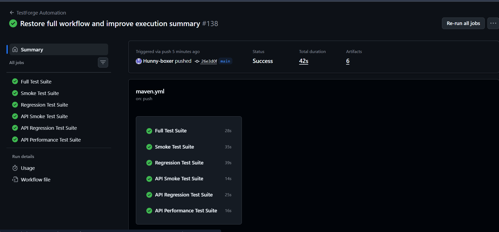
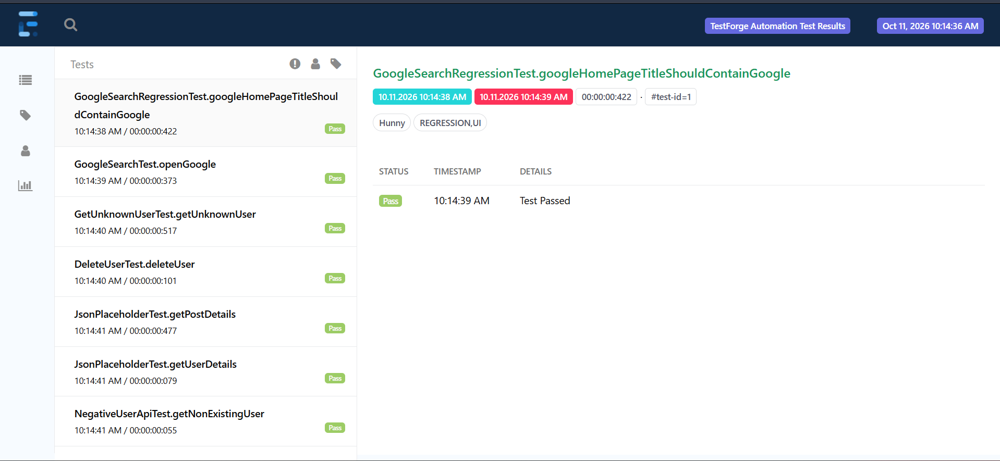
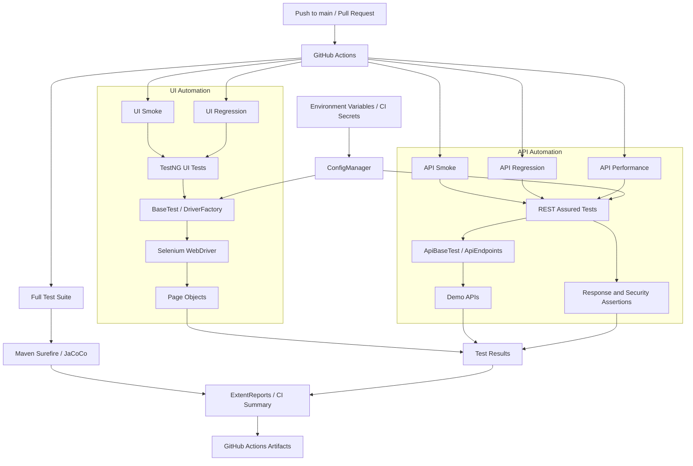

# 🚀 TestForge — UI & API Automation Framework

[](https://github.com/Hunny-boxer/testforge-automation/actions/workflows/maven.yml)


**TestForge** is a Java-based UI and API test automation framework designed to demonstrate reusable test architecture, API validation, negative testing, security assertions, performance checks, automated reporting, code coverage, and continuous integration.

The framework combines Selenium WebDriver, REST Assured, TestNG, Maven, ExtentReports, JaCoCo, and GitHub Actions.

**Repository:** [Hunny-boxer/testforge-automation](https://github.com/Hunny-boxer/testforge-automation)

**CI pipeline:** [GitHub Actions](https://github.com/Hunny-boxer/testforge-automation/actions)

**Architecture:** [Architecture documentation](docs/ARCHITECTURE.md)

---

## 📸 See TestForge in Action

### GitHub Actions — Continuous Integration

TestForge runs dedicated UI and API smoke, regression, and performance suites through GitHub Actions. The screenshot below shows the CI workflow view.



[View the latest CI runs](https://github.com/Hunny-boxer/testforge-automation/actions)

### ExtentReports — Test Execution Report

The repository includes a sample ExtentReports screenshot to illustrate how test execution results can be presented for review.



---

## ✨ Key Features

- **UI automation:** Selenium WebDriver with the Page Object Model.
- **API automation:** REST Assured for HTTP requests and response validation.
- **Negative testing:** Invalid resource IDs, malformed JSON, missing fields, and unsupported content types.
- **API security checks:** JSON content-type validation, `X-Content-Type-Options`, and checks for HSTS/CSP headers when present.
- **Authentication testing:** Missing bearer-token scenarios.
- **Configuration management:** System properties, environment variables, and properties-file defaults.
- **Credential management:** API tokens supplied through environment variables and GitHub Actions Secrets.
- **Schema validation:** JSON Schema assertions for API responses.
- **Performance checks:** Response-time assertions against a configurable code-level threshold.
- **Test organization:** TestNG groups and separate smoke, regression, and performance suites.
- **HTML reporting:** ExtentReports for reviewing test execution.
- **JUnit reporting:** Automated test results published in GitHub Actions.
- **Code coverage:** JaCoCo reports and raw coverage-data artifacts.
- **Continuous integration:** Six independent GitHub Actions jobs for UI and API testing.

## 🏗️ Architecture



### Main Components

| Component | Responsibility |
|---|---|
| `ConfigManager` | Loads settings from system properties, environment variables, or `config.properties` |
| `DriverFactory` | Manages Selenium WebDriver creation and cleanup |
| `GooglePage` | Encapsulates UI interactions using the Page Object Model |
| `ApiBaseTest` | Shared API setup, safe URI diagnostics, and sanitized error logging |
| `ApiEndpoints` | Centralized API endpoint definitions |
| `ApiResponseSpecification` | Reusable API response specifications |
| `ApiSecurityAssertions` | Validates response status, JSON content type, and selected security headers |
| `ExtentTestListener` | Integrates test execution with ExtentReports |
| TestNG | Test execution, groups, assertions, and suite configuration |
| Maven | Dependency management, test execution, and build lifecycle |
| GitHub Actions | CI execution, test summaries, and report artifacts |

## 🧪 Automated Test Coverage

TestForge combines unit, UI, API, security, negative, and performance tests.

### UI testing

The UI layer uses Selenium WebDriver and page objects to organize browser interactions. Dedicated smoke and regression jobs execute the configured UI test classes.

### API testing

The API framework tests representative JSONPlaceholder endpoints:

| Method | Endpoint | Purpose |
|---|---|---|
| GET | `/users/{id}` | Retrieve and validate user details |
| GET | `/posts/{id}` | Retrieve and validate post details |
| POST | `/users` | Test simulated user creation |
| PUT | `/users/{id}` | Test simulated user updates |

JSONPlaceholder is a demo API. Its write operations simulate responses rather than persist changes like a production database.

### Negative and security testing

Additional tests cover the following scenarios:

| Scenario | Expected behavior |
|---|---|
| Nonexistent user IDs | Expected HTTP 404 |
| Missing bearer token | Expected HTTP 401 from the authentication test endpoint |
| Malformed JSON | Expected HTTP 400 from the validation API |
| Missing required name | Expected HTTP 422 |
| Unsupported media type | Expected HTTP 415 |
| Invalid gender | Expected HTTP 422 |
| Incorrect response content type | Shared security assertions reject a response identified as non-JSON |
| Sensitive diagnostic data | URI, query values, and selected JSON fields are sanitized before diagnostic logging |

The validation tests use the configured GoREST test endpoint. Their assertions depend on the behavior of that external service.

**Important:** The status codes above are test expectations, not guarantees about every API. JSONPlaceholder and HTTPBin demonstrate API testing behavior; they do not represent a production authentication system or a complete security assessment.

## ✅ Verified CI Results

The following results were verified from successful GitHub Actions Run #180 on October 12, 2026.

| Metric | Result |
|---|---:|
| Full-suite tests | 48 passed |
| Full-suite failures | 0 |
| Full-suite skipped tests | 0 |
| API regression tests | 32 passed |
| API regression failures | 0 |
| API regression skipped tests | 0 |
| Workflow jobs | 6 passed |

[View successful Run #180](https://github.com/Hunny-boxer/testforge-automation/actions/runs/38234382760)

These figures describe that particular run. Test counts can change as the framework evolves, and separate suites can overlap, so their totals should not be added together to calculate unique tests.

## ⚙️ Configuration Management

TestForge uses `ConfigManager` to read configuration in the following order:

1. Java system property.
2. Environment variable.
3. `config.properties` default.

The following environment variables are supported:

| Environment variable | Purpose |
|---|---|
| `TESTFORGE_BASE_URL` | UI base URL |
| `TESTFORGE_BROWSER` | Browser selection |
| `TESTFORGE_API_BASE_URL` | API validation base URL |
| `TESTFORGE_API_TOKEN` | API validation token |

The default configuration file is located at:

`src/main/resources/config.properties`

Example:

```properties
baseUrl=https://www.google.com
browser=chrome
apiBaseUrl=https://gorest.in/public/v2/users
```

No API token should be stored in this file.

### Secure API credentials

The GitHub Actions workflow maps the repository secret `GOREST_API_TOKEN` to the environment variable `TESTFORGE_API_TOKEN` for the Full Test Suite and API Regression Test Suite.

To configure it:

1. Open the repository's **Settings**.
2. Go to **Secrets and variables → Actions**.
3. Select **New repository secret**.
4. Set the secret name to `GOREST_API_TOKEN`.
5. Enter the appropriate API token and save it.

Never commit real tokens to source code, properties files, or test logs.

When the token is unavailable, the GoREST validation tests skip explicitly rather than attempting an unauthenticated request.

## 🛡️ API Security Assertions

`ApiSecurityAssertions` provides reusable checks for:

- Expected HTTP status.
- Presence of `Content-Type`.
- JSON response content type.
- `X-Content-Type-Options: nosniff`.
- Basic validity of HSTS when present.
- Nonblank Content-Security-Policy when present.

The helper allows tests to reuse common checks rather than duplicating assertions.

**Scope note:** Optional headers are not required to exist by this helper. These checks are useful regression assertions, but they do not establish that an API is fully secure.

## ⚡ API Performance Validation

`ApiResponseTimeTest` measures response times for representative GET operations:

- `GET /users/{id}`
- `GET /posts/{id}`

The current response-time threshold is **10,000 ms**.

This is a pass/fail threshold, not a claim about normal or production latency. Actual response times vary with network conditions and the external demo service.

## 📊 ExtentReports and Test Results

TestForge generates HTML reports where configured and publishes JUnit test results through GitHub Actions.

| Artifact | Contents |
|---|---|
| `extent-report-full` | Full-suite report |
| `extent-report-smoke` | UI smoke report |
| `extent-report-regression` | UI regression report |
| `extent-report-api-smoke` | API smoke report |
| `extent-report-api-regression` | API regression report |
| `extent-report-api-performance` | API performance report |

### Download an ExtentReport

1. Open [GitHub Actions](https://github.com/Hunny-boxer/testforge-automation/actions).
2. Select a completed workflow run.
3. Find the **Artifacts** section.
4. Download the report ZIP.
5. Extract the archive and open `ExtentReport.html`.

Artifacts are retained according to the workflow's configured retention settings.

## 📈 JaCoCo Code Coverage

The Full Test Suite uses Maven verification to generate JaCoCo coverage outputs.

| Artifact | Contents |
|---|---|
| `jacoco-coverage-report` | HTML code-coverage report |
| `jacoco-coverage-data` | Raw JaCoCo execution data |

### Inspect coverage

1. Open [GitHub Actions](https://github.com/Hunny-boxer/testforge-automation/actions).
2. Select a completed Full Test Suite run.
3. Download `jacoco-coverage-report`.
4. Extract the ZIP archive.
5. Open `index.html` in a browser.

The coverage percentage should be read from the generated report. Coverage is a diagnostic metric and does not guarantee that assertions are meaningful or that every important scenario is tested.

## 🔄 Continuous Integration

The workflow is defined in `.github/workflows/maven.yml`.

It runs for configured pushes to `main` and pull requests targeting `main`.

The pipeline:

1. Checks out the repository.
2. Configures Java 17.
3. Sets up Chrome where UI tests require it.
4. Executes the appropriate Maven command.
5. Publishes JUnit test results.
6. Generates the full-suite execution summary.
7. Uploads ExtentReports artifacts.
8. Uploads JaCoCo reports and execution data for the full-suite job.

### CI suite commands

| Suite | Maven command |
|---|---|
| Full test suite | `mvn -B clean verify` |
| UI smoke | `mvn -B clean test -Dtest=GoogleSearchTest` |
| UI regression | `mvn -B clean test -Dtest=GoogleSearchRegressionTest` |
| API smoke | `mvn -B clean test -Papi-smoke` |
| API regression | `mvn -B clean test -Papi-regression` |
| API performance | `mvn -B clean test -Papi-performance` |

[View workflow runs](https://github.com/Hunny-boxer/testforge-automation/actions)

## ▶️ Run TestForge Locally

### Prerequisites

- JDK 17
- Maven
- Chrome for UI tests
- Internet access to download dependencies and call configured demo APIs

Run commands from the repository root.

**Full test suite**

```bash
mvn -B clean verify
```

**UI smoke**

```bash
mvn -B clean test -Dtest=GoogleSearchTest
```

**UI regression**

```bash
mvn -B clean test -Dtest=GoogleSearchRegressionTest
```

**API smoke**

```bash
mvn -B clean test -Papi-smoke
```

**API regression**

```bash
mvn -B clean test -Papi-regression
```

**API performance**

```bash
mvn -B clean test -Papi-performance
```

### Run the API validation tests

Set `TESTFORGE_API_TOKEN` in your environment before running:

```bash
mvn -Dtest=ApiValidationNegativeTest test
```

In PowerShell, configure the token for the current terminal session:

```powershell
$env:TESTFORGE_API_TOKEN = "YOUR_ACTUAL_TOKEN"
```

Replace the placeholder locally with your own token. Never commit the token or share it in chat.

## 📁 Project Structure

```text
testforge-automation/
├── .github/
│   └── workflows/
│       └── maven.yml
├── docs/
│   ├── ARCHITECTURE.md
│   ├── extent-report-sample.png
│   └── testforge-ci-run.png
├── src/
│   ├── main/
│   │   ├── java/com/hunny/testforge/
│   │   │   ├── config/
│   │   │   │   └── ConfigManager.java
│   │   │   ├── driver/
│   │   │   │   └── DriverFactory.java
│   │   │   └── pages/
│   │   │       └── GooglePage.java
│   │   └── resources/
│   │       └── config.properties
│   └── test/
│       ├── java/com/hunny/testforge/
│       │   ├── api/
│       │   ├── base/
│       │   ├── config/
│       │   ├── driver/
│       │   ├── reporting/
│       │   ├── tests/
│       │   └── utils/
│       └── resources/
│           ├── schemas/
│           ├── testdata/
│           └── testng*.xml
├── pom.xml
├── LICENSE
└── README.md
```

## 🗺️ Roadmap

Potential future improvements include:

- Environment-specific QA, staging, and production configurations.
- Additional API contract and boundary-value tests.
- Historical response-time trend reporting.
- Configurable coverage quality gates.
- Broader integration testing.
- More comprehensive framework utility tests.

These are possible future enhancements, not claims that all have already been implemented.

## 👨‍💻 Author

**Hunny Boxer**

GitHub: [@Hunny-boxer](https://github.com/Hunny-boxer)

---

*TestForge is a portfolio project demonstrating UI and API automation, reusable test architecture, negative testing, security assertions, configuration management, reporting, code coverage, and continuous integration.*
