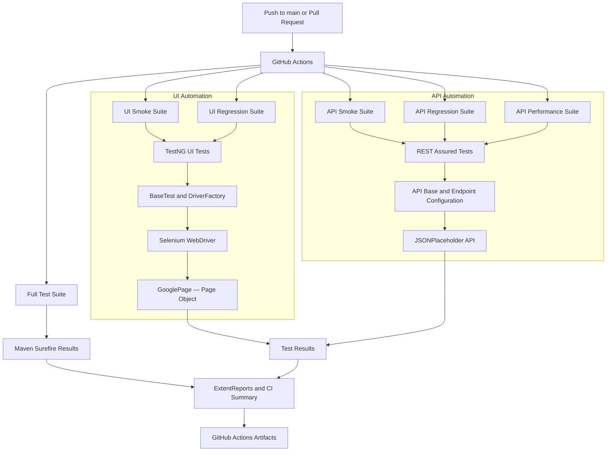

# TestForge — Architecture & Execution Flow

## Overview

TestForge is a Java-based UI and API automation framework using Selenium WebDriver, REST Assured, TestNG, Maven, ExtentReports, and GitHub Actions.

The framework separates browser-based tests from API tests and runs the test suites independently in CI.

## Architecture Diagram

## Main Components

| Component | Responsibility |
|---|---|
| `config` | Loads test configuration such as the browser setting |
| `driver` | Initializes and manages the Selenium WebDriver |
| `pages` | Encapsulates UI interactions using the Page Object Model |
| `base` | Provides shared test setup, teardown, and report lifecycle |
| `api` | Contains API endpoints, request setup, response checks, and performance tests |
| `reporting` | Captures test outcomes and produces ExtentReports |
| `testng*.xml` | Defines TestNG suite and group configuration |
| `pom.xml` | Manages Maven dependencies, build plugins, and test profiles |
| `.github/workflows/maven.yml` | Defines the six CI jobs and their report uploads |

## Execution Flow

1. A push to `main` or a pull request targeting `main` triggers GitHub Actions.
2. Each job checks out the repository and configures Java 17.
3. UI jobs prepare Chrome and execute their selected UI test class.
4. API jobs run the configured API smoke, regression, or performance profile.
5. TestNG executes tests while the framework listener records results for ExtentReports.
6. Maven Surefire produces test result XML files.
7. The full-suite job publishes a GitHub Actions execution summary.
8. Each job attempts to upload its generated HTML report as a downloadable artifact.

## Test Suites

| Suite | Purpose |
|---|---|
| Full Test Suite | Executes the complete configured test set |
| UI Smoke | Checks the Google homepage smoke scenario |
| UI Regression | Checks the Google homepage title scenario |
| API Smoke | Runs API tests selected by the `SMOKE` group |
| API Regression | Runs API tests selected by the `REGRESSION` group |
| API Performance | Measures selected API response times against the configured threshold |

## Reports and Troubleshooting

Open the relevant workflow run in GitHub Actions to review job status, logs, and the published execution summary.

Download the relevant `extent-report-*` artifact to inspect HTML test details. If an artifact is missing, check the job log for the report upload step and confirm that the report file was generated.

## Repository

- [Source code](https://github.com/Hunny-boxer/testforge-automation)
- [GitHub Actions runs](https://github.com/Hunny-boxer/testforge-automation/actions)
- [README](../README.md)
